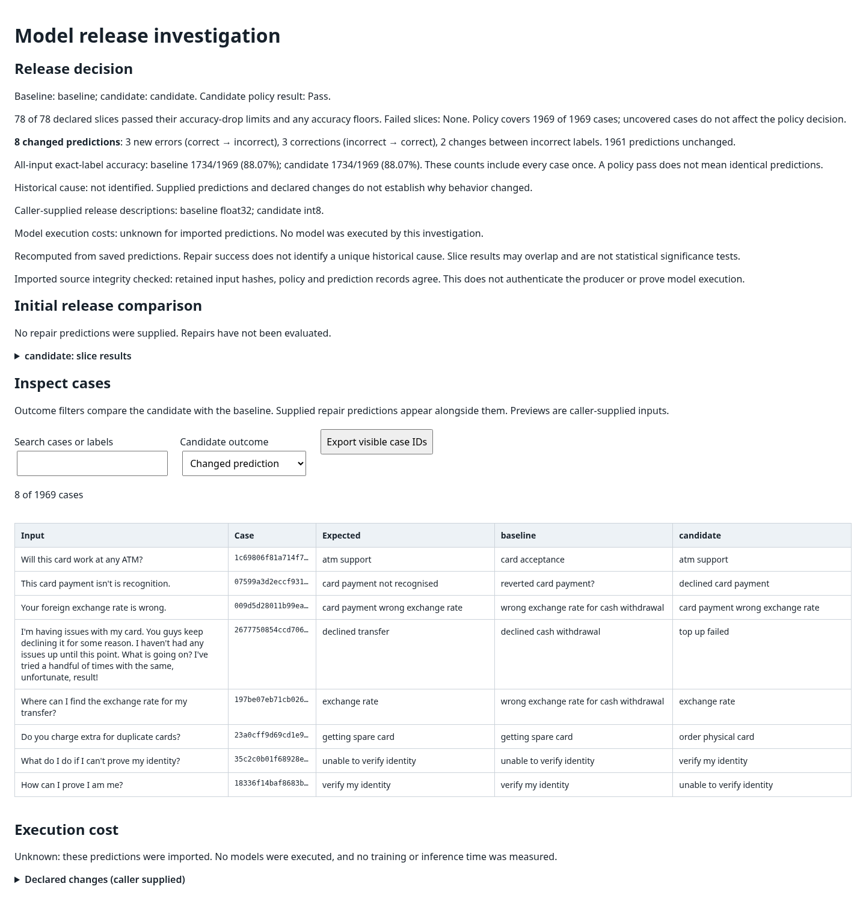

# Model Regression Forensics

Compare classification releases, inspect changed predictions and check proposed repairs against declared requirements. MRF produces a local HTML report from saved predictions or explicit model callbacks.

**Status:** maintained comparison utility; the accompanying localization study is complete. Further comparative research is deferred.

[Walkthrough](docs/deployment-comparison.md) · [Input format](docs/import-predictions.md) · [Architecture](docs/architecture.md) · [Research report](research/M4_TECHNICAL_REPORT.md)

## Run the example

From a checkout with Python 3.12 or later:

```bash
python -m pip install .
mrf-import examples/deployment_comparison/policy.json examples/deployment_comparison/predictions.csv deployment-investigation
```

Use a new output directory, then open `deployment-investigation/index.html`. No training, model download or report server is needed. Installation requires access to package dependencies.



The example compares 1,969 predictions. Eight labels change: three new errors, three corrections and two changes between incorrect labels. The candidate still passes its declared slice policy; changed behaviour is not automatically a policy failure. Repairs are not evaluated in this example.

Banking77 text: PolyAI, Casanueva et al. (2020), [CC BY 4.0](https://creativecommons.org/licenses/by/4.0/), [dataset source](https://github.com/PolyAI-LDN/task-specific-datasets). Changes include case selection, predictions and report grouping. [Screenshot provenance](docs/deployment-comparison.md#published-report-capture).

## What the tool establishes

MRF checks case and label alignment, declared slice membership, accuracy thresholds and supplied repairs. It records changed examples and rejects incompatible evaluation records.

A passing repair shows restoration under a specified policy, not proof of the historical cause. A deterministic [ambiguity example](docs/ambiguous-repairs.md) demonstrates two distinct repairs restoring identical predictions. The output reports that ambiguity rather than selecting a cause.

The tool does not establish statistical significance, general causal identification or independent-user benefit. It is narrower than general monitoring and interpretation tools such as Evidently and Google LIT; comparative superiority is not claimed.

## Completed study

Two constructed Banking77 benchmarks each contain five candidate label-swap changes. A DistilBERT classifier was trained across three paired trajectories per benchmark; rankings were finalized before truth scoring.

| Diagnostic | Benchmark A root rank | Benchmark B root rank |
| --- | ---: | ---: |
| Deterministic random reference | 3 | 3 |
| Target-label overlap | 1 | 1 |
| Lexical Jaccard | 1 | 1 |
| Final-checkpoint Grad-Dot | 1 | 5 |
| Seven-checkpoint TracIn | 1 | 5 |

The model-based diagnostics added no top-1 benefit over simple baselines in this design. Known target labels and disjoint candidate label pairs give the overlap baseline a semantic shortcut. The repeated training trajectories are not additional independent benchmarks.

These findings concern localization in two constructed settings, not general root-cause diagnosis. No peer-reviewed publication is claimed.

## Documentation

- [Replay the saved research results](research/REPRODUCE_M4.md)
- [Accepted result record](research/M4_RESULT.json)
- [Experiment history](research/EXPERIMENT_HISTORY.md)
- [Prediction and repair walkthroughs](docs/banking-investigation.md)
- [Scope and deferred work](research/ROADMAP.md)

For development with Python 3.12 or later and `uv`:

```bash
uv sync --extra dev
uv run ruff check .
uv run ruff format --check .
uv run pytest
```

Research-only checks require the optional dependencies documented in their reproduction instructions. Saved-result replay does not retrain the models.

## Licensing

There is no project-wide software licence grant. Public source visibility does not grant general reuse rights; third-party materials retain their stated terms.
